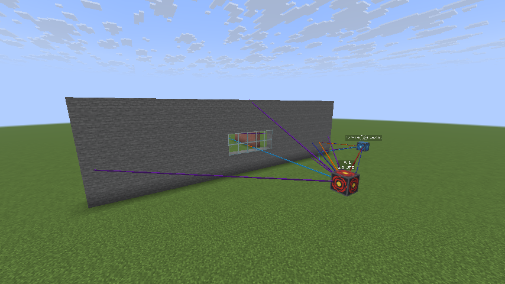

# mc-sionna

Run [NVIDIA Sionna RT](https://github.com/NVlabs/sionna-rt) radio ray tracing on a Minecraft world.
Place a **Radio Transmitter** and one or more **Radio Receiver** blocks. The mod sends the blocks around
them to a small Python service, Sionna traces the radio paths on the GPU, and the paths show up in game
as colored beams. Every run also saves the Sionna scene (XML + meshes) and the channel data.



Two parts:

- `src/mc_sionna/`: Python service (Sionna RT 2.2, run with uv). It turns blocks into a scene, traces paths, and writes exports.
- `mod/`: Fabric mod for Minecraft **26.3** (Java 25). It adds the two blocks and the `/sionna` command, and draws the rays.

Every command in one place: [COMMANDS.md](COMMANDS.md).

## Join a server


Client: Minecraft **26.3** + Fabric, with [Fabric API](https://modrinth.com/mod/fabric-api) and `mc-sionna-0.1.0.jar` (from `server/mods/`).

The server lives in `server/`. Start it with `server/start.sh` and the service with `uv run mc-sionna-server`, both inside `tmux` sessions. `server/` is in creative mode, with the allowlist off and Microsoft logins required. Its world, logs and settings stay out of git.

## Run your own

1. Start the Sionna service on a machine with an NVIDIA GPU:

   ```bash
   uv run mc-sionna-server
   ```

   It listens on `127.0.0.1:8765`. Each `/sionna run` is saved to `exports/<timestamp>/`.

2. Build the mod (or use the jar in `mod/build/libs/`):

   ```bash
   cd mod && JAVA_HOME=../.tools/jdk-25.0.5+8 ./gradlew build
   ```

3. Install it like any Fabric mod: Minecraft **26.3** + Fabric, with [Fabric API](https://modrinth.com/mod/fabric-api) and `mod/build/libs/mc-sionna-0.1.0.jar`.

4. In a world (creative mode is easiest), find **Radio Transmitter** and **Radio Receiver** in the Functional Blocks tab, or run `/give @s mc_sionna:transmitter`. Place one of each. The rays update live: when a radio block is placed or broken, and when any block changes near the radios (at most twice a second). Run `/sionna run` to save the scene and channels.

**If Minecraft runs on a different computer than the GPU** (for example a laptop, with the GPU box reached over SSH), forward the port. The mod's default address then works as is:

```bash
ssh -N -L 8765:127.0.0.1:8765 your-gpu-box
```

## In game

| Command | What it does |
|---|---|
| `/sionna run` | Trace paths for every transmitter and receiver within `radius` blocks of you, and save the scene + channels |
| `/sionna clear` | Remove all drawn rays and labels |
| `/sionna settings` | Show the current settings |
| `/sionna set <key> <value>` | Change a setting (anyone can, except `url`, which needs op). Saved to `config/mc-sionna.properties` |

Settings:

| Key | Default | Meaning |
|---|---|---|
| `url` | `http://127.0.0.1:8765` | Where the Python service is |
| `radius` | `48` | Half-size of the cube of blocks sent to Sionna (max 128) |
| `auto_run` | `true` | Live updates: re-run (without saving) when a radio block is placed or broken, or a block changes near the radios |
| `frequency_ghz` | `3.5` | Carrier frequency |
| `max_depth` | `4` | Max interactions per path. Each wall crossing uses two, one for each face |
| `max_drawn_paths` | `100` | How many of the strongest paths get drawn (all paths are still exported) |
| `diffraction` | `false` | Turn on Sionna's edge diffraction (slower, and see the limits below) |
| `thickness_per_block_m` | `0.2` | How much real material one block of wall stands for (see below) |

Ray colors go by power: **red** is the strongest path, then orange, yellow, lime, light blue, blue, and purple, with each step 6 dB weaker. A label over each receiver shows its total path gain, number of paths, and RMS delay spread.

## What gets saved

Each `/sionna run` makes `exports/<timestamp>/` with (live updates save nothing):

- `scene.xml` plus `meshes/*.ply`: the exact scene that was simulated. It loads on its own with `sionna.rt.load_scene("scene.xml")`.
- `channels.npz` and `channels.mat` (same contents, `.mat` for MATLAB):
  - `a`, `tau`: per-path complex baseband gains and absolute delays, shape `[rx, tx, path]`
  - `valid`: which path slots are real paths
  - `h_freq`: frequency response `[rx, tx, subcarrier]`, at `frequency_hz + subcarrier_offsets_hz` (100 MHz, 256 subcarriers)
  - `vertices`, `interactions`: bounce points and bounce types for every path
  - `tx_positions`, `rx_positions`, `origin_mc`
- `paths.json`: the drawn paths in Minecraft coordinates
- `metadata.json`: settings, link summaries, warnings, and the coordinate mapping

Coordinates: the scene is z-up with the region's corner at the origin. A Minecraft point `(x, y, z)` becomes `(x - ox, -(z - oz), y - oy)` in the scene, where `(ox, oy, oz)` is `origin_mc`. Antennas sit at block centers. Antennas are single isotropic, vertically polarized elements.

## How blocks become a radio scene

- **Materials** come from a name-based table in [`materials.py`](src/mc_sionna/materials.py), because Minecraft blocks no longer carry a material property:
  - stone and similar blocks: ITU concrete
  - bricks: brick
  - quartz: marble
  - planks and logs: wood
  - glass: glass
  - iron, gold, and copper: metal
  - dirt, sand, and mud: ITU ground types
  - water, ice, and snow: custom values
  - wool: carpet tile

  Blocks with no rule are treated as concrete and listed in a chat warning. Edit the table to change any of this.
- **Treated as air:** leaves, flowers, grass, torches, fences, rails, and similar small blocks. Sionna can't model foliage as a lossy volume, and solid leaf cubes would make every tree a wall.
- **Surfaces:** only block faces that touch air are kept, and neighboring faces of the same material are merged into big rectangles. Faces on the outer edge of the region are dropped, so the cut-off underground doesn't become a giant wall.
- **Wall thickness:** Sionna sets a thickness per material, not per surface, so each material gets one copy per wall depth (`concrete-1`, `concrete-2`, ...; exact up to 8 blocks, then rounded down to 16, 32 or 64). Each face carries half of `depth x thickness_per_block_m`, so a ray crossing the wall goes through the full amount. At the default 0.2 m per block, a 1-block wall acts like a normal 20 cm wall, and thicker walls lose more. Set it to `1.0` for true 1 m blocks, which makes almost every wall opaque. Glass is always 6 mm per face, like a real window. A wall made of layers of different blocks counts all its depth but only the materials of its two outer faces.
- **Paths that bounce inside a wall are dropped.** Sionna sees a wall as two thin sheets with empty space between them, so on its own it finds rays that cross one face and then reflect off the wall's other faces from the inside. Those don't exist, so they are removed before anything is drawn or exported.
- **Frequencies outside a material's ITU range** (the ground types only cover 1-10 GHz) use the closest ITU values and print a warning, instead of failing.

## Limits

- **Drawing:** rays are drawn as `block_display` entities, so every player sees them, including players without the mod. A few thousand pieces is fine; tens of thousands will lag. Raise `max_drawn_paths` with care.
- **Old drawings:** `/sionna clear` and new runs remove rays in loaded chunks. Rays saved in chunks that aren't loaded are thrown away when those chunks load, and drawings don't survive a server restart.
- **Unloaded areas:** chunks that aren't loaded count as air, rather than making the server generate them.
- **Diffraction:** when on, Sionna only finds edges where merged rectangles share corners exactly, and never between two different materials. Expect it to miss many building corners.
- **Block shapes:** every block with collision counts as a full cube: slabs, stairs, panes, and doors.
- **One request at a time:** the service handles one request at a time. The mod runs the latest request when the current one finishes (a pending `/sionna run` is never dropped).
- **Live update speed:** moving or adding radios reuses the loaded scene (about 0.01 s). Changing blocks makes Sionna load a new scene and recompile its GPU code: about 0.5 s on a small area, a few seconds on a full-size one.

## Development

```bash
uv run pytest                     # meshing + full Sionna run on a small fake world
uv run ruff check && uv run ty check src
```

To test the whole thing against a real server:

1. Start the service:

   ```bash
   uv run mc-sionna-server
   ```

2. Start the dev server on port 25566. Its settings come from `mod/dev-server.properties` (offline players, remote console on), copied into `mod/run/` on each start:

   ```bash
   cd mod && JAVA_HOME=../.tools/jdk-25.0.5+8 ./gradlew runServer --args=nogui
   ```

3. Build a test scene through the remote console, trace it, and check for rays, labels, and exports:

   ```bash
   uv run python scripts/e2e.py
   ```

`./gradlew runClient` starts a dev client (offline player name) that can join `127.0.0.1:25566`.

JDK 25 is unpacked in `.tools/`. It's ignored by git; download Temurin 25 again if it's missing.
